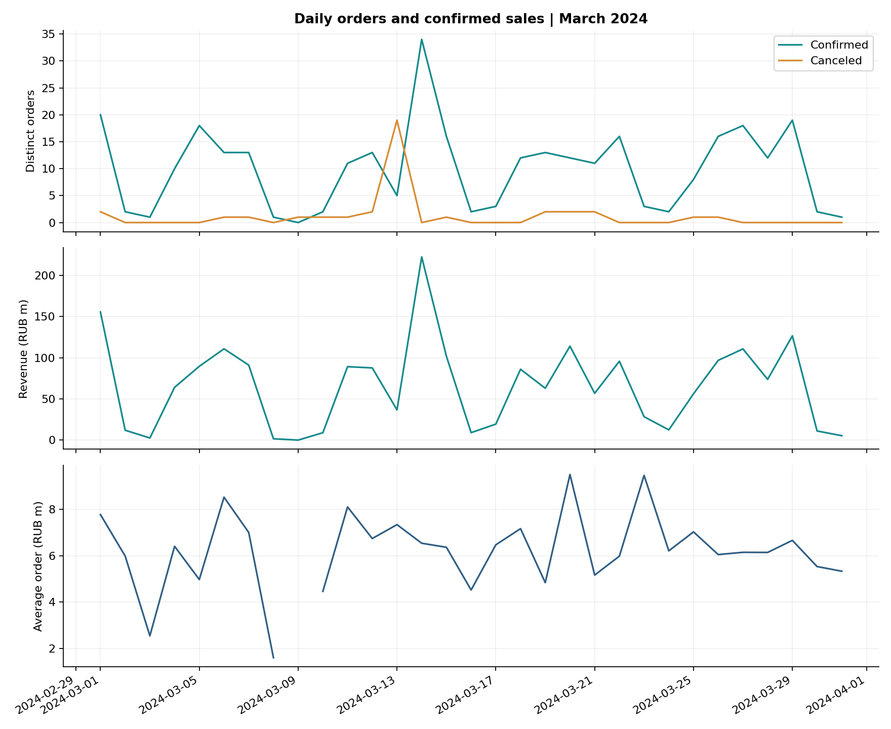

# Wholesale Sales & Order Analytics

A reproducible Python portfolio project investigating sales, cancellations and product demand in a wholesale audio business. Extended from the Python final project at **karpov.courses**. Dataset: March 2024, educational records.



## Business question

Did the mid-month spike represent new demand, or did repeated orders inflate the apparent growth? Which brands, products and clients contributed to the month's sales?

## Results

| Measure | Result |
|---|---:|
| Source CSV files | 382 |
| Order lines / distinct orders | 4,603 / 346 |
| Confirmed / canceled orders | 309 / 37 |
| Confirmed order value, RUB | 2,038,231,821.56 |
| Average confirmed order, RUB | 6,596,219.49 |
| Cancellation rate | 10.69% |
| Catalog products / products without confirmed sales | 1,677 / 497 |
| Exact next-day reorder candidates | 16 |
| Top five clients' revenue share | 15.56% |

On March 13 there were **19 canceled and 5 confirmed orders**. On March 14 there were **34 confirmed orders**. Sixteen of those 34 orders (**47.06%**) had an identical canceled basket the previous day, with the same client and manager. This supports a reordering explanation; it does not establish a CRM outage. Their RUB 115,285,027.45 confirmed value is already included in monthly revenue.

JBL generated the most brand revenue. Маргарита Камертонова led manager revenue, while Виктор Тромбонов led confirmed order count. These measure different dimensions of results, not individual ability.

## Quick start

Python 3.10+ recommended. From the extracted project folder:

```bash
python -m venv .venv
# Windows: .venv\Scripts\activate
# macOS/Linux: source .venv/bin/activate
python -m pip install -r requirements.txt
python run_analysis.py
python -m unittest discover -s tests -v
jupyter lab notebooks/sales_analysis.ipynb
```

**No installation is needed to view the delivered dashboard:** open `reports/dashboard.html` directly in a browser. It contains the data and charts locally, without a server or CDN. Filters cover date, manager, brand and category. The anomaly, ABC and concentration sections are explicitly full-month results. The dashboard also exports filtered rows as CSV.

## Repository contents

- `src/analysis.py`: file discovery, validation, joins, metric calculations, exact basket matching and ABC classification.
- `run_analysis.py`: rebuilds CSV outputs, JSON summaries, charts and HTML dashboard.
- `src/dashboard.html`: editable dashboard template.
- `notebooks/sales_analysis.ipynb`: executed narrative analysis with explanations in Russian.
- `reports/findings.md`: business findings, proposed follow-up and limitations.
- `reports/validation.json`: data validation results and runtime versions.
- `tests/test_analysis.py`: seven automated checks including independent revenue reconciliation and synthetic matching edge cases.
- `GUIDE_RU.md`: explanation, launch instructions and interview preparation.

## Methodology

Each source `orders.csv` row is one product in one order. Dates and managers come from directory names; categories come from product directories. Manager names are normalized to Unicode NFC. Orders join to status by `order_id`, products by `product_id = id`, and FX by `date`; each join is checked as many-to-one.

- Revenue follows the course convention: `quantity × USD price × daily USD/RUB rate`, confirmed orders only. This is gross order value; profitability cannot be calculated without costs. No intermediate monetary rounding is applied.
- Cancellation rate: distinct canceled orders / all distinct orders. AOV: confirmed value / distinct confirmed orders. No-sale days have zero revenue and undefined AOV.
- Brand/category order counts are non-additive: a single order may contain several brands or categories. Filtered dashboard AOV uses only the selected basket lines.
- Reorder candidates require the same client, manager and exact sorted `(product_id, quantity)` basket on the following calendar day. Repeated identical candidates are paired deterministically one-to-one and marked ambiguous.
- ABC: descending confirmed product revenue, ID as tie-breaker. The item crossing 80% remains in A, and the item crossing 95% remains in B. Zero-sales items are separate.
- Catalog review: at least 15 products and more than 50% without confirmed sales. This uses `>=15`, consistent with the task wording, even though its hint says `>15`.

## What extends the course

Exact basket comparison replaces aggregate-count matching. Added explicit validation, independent reconciliation, one-to-one ambiguity handling, ABC analysis, client concentration, an offline interactive dashboard and reusable pipeline with tests. Course logic and data source are acknowledged rather than presented as commercial experience.

## Limitations and next steps

Only one month is available. No stock availability, margins, lead histories, manager targets, technical logs or subsequent customer behavior are supplied. No-sales products are review candidates, not a recommendation for immediate delisting. Weekday variation is descriptive, not evidence of long-term seasonality. Manager comparisons are not adjusted for account portfolios or assigned workload. Confirm incident logs and review a longer period before taking action.

## Data and publication

See `data/README.md`. Raw course data and detailed exports are included in this private delivery for reproduction but ignored by Git. Before publicly publishing raw data or the embedded dashboard, establish redistribution permission. The project has not been pushed to GitHub or deployed.

## Validation

Run `python -m unittest discover -s tests -v`. Data validation is performed on each pipeline run. `reports/validation.json` records the versions used for the delivered analysis. Dashboard logic checks are recorded in `reports/browser_checks.json`. JavaScript filters, totals, empty state, reset and export handler were exercised in Node with a minimal DOM adapter. Full browser rendering was not verified because Chromium was unavailable and its download failed.
